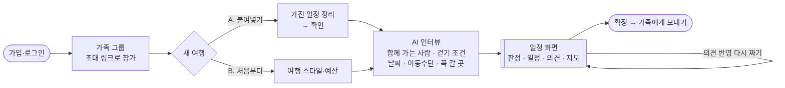
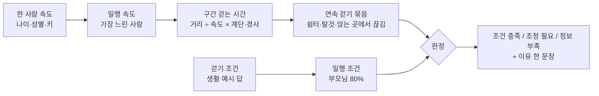
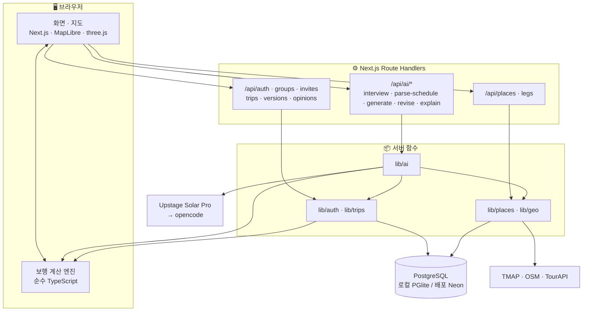

<div align="center">

# 🚶‍♀️ 보폭 · BoPok

### 부모님 걸음에 맞춘 대전 가족 여행 플래너

관광지 안에서 걸어야 하는 길까지 미리 보고, 부모님 걷기 조건으로 판정하고,<br/>
가족이 함께 의견을 모아 AI와 일정을 다시 짜는 웹 서비스

<br/>


[왜 보폭인가](#-왜-보폭인가) · [주요 기능](#-주요-기능) · [사용 흐름](#-사용-흐름) · [걷는 시간 계산](#-걷는-시간은-이렇게-계산해요) · [구조](#%EF%B8%8F-시스템-구조) · [팀](#-팀과-역할) · [시작하기](#-시작하기)

</div>

<br/>

## 💡 왜 보폭인가

> "막상 가 보니 두 시간을 걸어야 했고, 계단으로만 갈 수 있는 길이었어요."

부모님과 여행을 가면 일정은 보통 자녀가 짜고, 부모님 의견은 잘 들어가지 않습니다. 그리고 걷는 길의 불편은 관광지에 도착해서야 드러납니다.

**보폭**은 이 문제를 **여행 전에** 풀어 줍니다.

- 관광지마다 계단·쉼터가 어디 있고 걸어서 얼마나 걸리는지 보여 줍니다.
- 그 정보를 부모님 걷기 조건과 맞춰 봅니다.
- 가족이 함께 보면서 의견을 맞춥니다.

목표는 "부모님이 좋아하실 곳을 맞히는 것"이 아니라 **부모님이 큰 불편 없이 만족스럽게 다녀오시는 것**입니다.

<br/>

## ✨ 주요 기능

| | 기능 | 설명 |
| :---: | --- | --- |
| 🪜 | **관광지 안 걷는 길** | 주차장·정류장 → 입구 → 볼거리 → 출구까지 구간마다 계단 칸 수, 경사, 쉼터(실내/야외), 걷는 시간을 보여 줍니다. 서비스에서 가장 중요한 기능입니다. |
| ✅ | **부모님 조건으로 판정** | 조건 충족 · 조정 필요 · 정보 부족 세 가지로 판정합니다. 이유는 *"한밭수목원에서 국립중앙과학관까지 쉬지 않고 약 27~33분을 걸어야 해요 (조건 20분)"*처럼 한 문장으로 보여 줍니다. |
| 🩹 | **빠른 수정안 A·B·C** | A는 계단 대신 우회로를 쓰고 선택 구간을 뺍니다. B는 A에 쉼터에서 쉬기를 더합니다. C는 B에 장소 사이를 택시로 바꾸기를 더합니다. 문제가 처음 풀리는 단계까지 보여 줍니다. |
| 👨‍👩‍👧 | **가족이 함께** | 가족 그룹을 만들고 초대 링크로 부릅니다. 부모님도 자기 계정으로 들어와 걷기 조건과 의견을 직접 남깁니다. |
| 💬 | **의견과 버전** | 장소마다 반응 버튼과 한 줄 의견을 남길 수 있습니다. 일정은 모든 버전이 저장되어 서로 비교할 수 있습니다. |
| 🤖 | **AI 일정** | 인터뷰로 칸을 채우고, 붙여넣은 일정을 정리합니다. 처음부터 일정을 짜거나, 의견을 반영해 다시 짤 수도 있습니다. 어떤 경우든 판정은 계산 엔진이 다시 합니다. |
| 🗺️ | **3D 대전 지도** | 일정과 지도를 1:1로 나란히 보여 줍니다. 경로는 부담 정도에 따라 색이 다르고, "! 계단 24칸" 표시와 쉼터 핀이 있습니다. 일정을 고치면 바로 다시 판정합니다. |
| 📤 | **가족에게 보내기** | 확정한 일정을 카톡·문자로 바로 읽을 수 있는 글로 보냅니다. 걷는 시간, 쉬는 곳, 연락처가 들어갑니다. |

<br/>

## 🧭 사용 흐름



일정 화면에서 할 수 있는 일:

- 장소 순서·시간·이동수단 직접 고치기 → 새 버전
- 가족 누구나 장소별 반응·의견 남기기
- "의견 반영해서 다시 짜기"(AI)나 빠른 수정안(계산)으로 새 버전 만들기
- **조건 바꿔 보기**로 걷기 조건을 잠깐 바꿔 판정을 미리 보기(저장하지 않음)

<br/>

## 🛡️ 지키는 약속

| 약속 | 이렇게 지켜요 |
| --- | --- |
| **"계단 없음"은 확인한 곳에만** | 사람이 확인한 구간(`confirmed_none`)에만 "계단 없음"이라고 씁니다. 기록이 없으면 "계단 기록 없음 (지도 데이터 기준)"이라고 씁니다. |
| **숫자는 계산 엔진만** | 걷는 시간, 계단 수, 판정은 엔진에서만 나옵니다. AI가 쓴 문장에 엔진 결과에 없는 숫자나 "계단이 없다"는 말이 있으면 버리고 정해진 문장을 씁니다. |
| **시간은 범위와 추정치로** | "약 15~20분 · 추정치"처럼 보여 줍니다. 판정 근거에는 출처, 확인 날짜, 신뢰 등급(A 공식·현장 / B 지도 측정 / C 사진·후기)을 붙입니다. |
| **추천은 우리 장소 DB 안에서** | AI는 검증한 장소 목록 안에서만 고릅니다. 목록 밖 장소는 버립니다. |
| **부모님이 쓰기 쉬운 화면** | 큰 글씨, 쉬운 말, 가/가+ 버튼을 쓰고 상태는 색과 글자로 함께 보여 줍니다. 인터뷰는 큰 선택 버튼 위주로 진행합니다. |
| **부모님 말씀이 먼저** | 걷기 조건은 부모님 답에 80% 비중을 둡니다. 다시 짜기에서 의견이 부딪히면 부모님 의견을 따릅니다. |

<br/>

## 🧮 걷는 시간은 이렇게 계산해요



| 단계 | 규칙 | 근거 |
| --- | --- | --- |
| 한 사람 속도 | 나이대·성별 평균 속도에 키를 보정합니다. '천천히'라고 답하면 0.85 m/s 이하, 보행 보조기구를 쓰면 0.73 m/s 이하로 잡습니다. | Andrews 외 2023(성인 51,248명 메타분석), Pua 외 2022, 한음 외 2020 |
| 일행 속도 | 함께 가는 사람 중 가장 느린 사람에 맞춥니다. | 설계 7.1 |
| 일행 조건 | 부모님 답에 80% 비중을 둡니다. 자녀 답은 부모님 기준을 더 엄격하게 만들 때만 반영하고, 더 느슨하면 부모님께 확인 카드를 띄웁니다. | 설계 7.1.1 · 7.1.3 |
| 구간 시간 | 거리 ÷ 속도 × 계단 가중치 × 경사 가중치로 구합니다. 범위의 위쪽 끝(×1.2)을 조건과 비교합니다. | 설계 7.2 |
| 연속 걷기 | 쉼터·탈것·앉는 장소(식사·카페)에서만 끊깁니다. 관람 장소 사이를 걸어서 이동하면 이어서 셉니다. | 설계 7.3 |
| 모르는 구간 | 경로 정보가 없으면 시간을 지어내지 않고 '정보 부족'으로 둡니다. | 설계 2.3 |

<br/>

## 🏗️ 시스템 구조



- **계약이 경계입니다.** API 요청·응답과 공용 타입은 `src/lib/contracts`에 zod 스키마로 먼저 정하고, 서버는 받은 값을 반드시 이 스키마로 검사합니다.
- **엔진은 브라우저와 서버에서 똑같이 돕니다.**
  - 브라우저는 일정이 바뀔 때마다 즉시 다시 판정합니다.
  - 서버는 버전을 저장하거나 AI가 일정을 만들 때 판정합니다.
  - 같은 입력이면 항상 같은 결과가 나옵니다.

<br/>

## 🧰 기술 스택

| 영역 | 사용 |
| --- | --- |
| 프레임워크 | Next.js 16 (App Router) · React 19 · TypeScript |
| 스타일 | Tailwind CSS 4 |
| 데이터 | PostgreSQL(개발은 로컬 PGlite, 배포는 Neon) · Drizzle ORM |
| 로그인 | Better Auth (이메일·비밀번호) |
| 지도 | MapLibre GL · OpenFreeMap · three.js(3D 건물·나무) |
| AI | Upstage Solar Pro, 막히면 opencode로 대체 · 출력은 zod로 검사 |
| 경로·장소 | TMAP 보행자 경로·POI 검색 · OSM 계단·쉼터·화장실 · 한국관광공사 TourAPI |
| 품질 | Vitest · ESLint · `pnpm build` 타입 검사 |
| 배포 | Vercel |

<br/>

## 👥 팀과 역할

> 아래는 **완성품 기준으로 각자 만드는 것**입니다. 자세한 설계와 작업 순서는 각자의 역할 문서에 있습니다.

<table>
<tr>
<td width="50%" valign="top">

### 🎨 오하연 · 프론트엔드
[@aress7578-lgtm](https://github.com/aress7578-lgtm) · [역할 문서](docs/roles/frontend.md) · 브랜치 `fe/`

**모든 화면과 지도**

- **화면 9개**: 첫 화면(3D 대전 히어로), 가입·로그인, 내 그룹, 초대 받기, 그룹(여행 목록·구성원·초대 링크), 새 여행(붙여넣기/처음부터·스타일·예산), 일정, 여행자 정보 고치기, 확정 일정
- **일정 화면** (서비스의 중심)
  - 가로 1:1 화면: 왼쪽에 판정 배지·이유·요약 카드·일정 목록, 오른쪽에 지도
  - 일정이 바뀌면 엔진으로 바로 다시 판정
  - 직접 고치기, 조건 바꿔 보기
  - 빠른 수정안 카드, 장소별 반응·의견, 버전 비교
- **3D 지도**: 부담 정도에 따라 색이 다른 경로, "! 계단 24칸", 쉼터 핀(실내/야외), 주차장·정류장 핀, 2D/3D 전환, 목록 ↔ 지도 구간 연동
- **인터뷰 대화창**: 큰 선택 버튼(칩) + 직접 입력
- **확정 일정·가족에게 보내기**: 공유하기, 안 되면 복사하기
- **공통**: 가/가+ 글씨 크기 버튼, 쉬운 말, 목업 모드, API 호출 모음(`api-client`)

</td>
<td width="50%" valign="top">

### 🔐 김경선 · 계정·그룹·여행·버전·의견
[@gyeongseon-k](https://github.com/gyeongseon-k) · [역할 문서](docs/roles/account-trip.md) · 브랜치 `acct/`

**가족이 함께 쓰는 데이터 전부**

- **로그인**: Better Auth 이메일 가입·로그인
- **권한 함수**: 모든 API의 방어선 `requireUser` · `requireMember` · `requireOwner`
- **그룹·초대**: 그룹 만들기, 7일짜리 초대 링크(여러 명 사용 가능), 링크로 참가, 구성원 내보내기
- **여행·여행자**: 여행 만들기·목록, 함께 가는 사람과 걷기 조건 저장·수정(부모님 본인 입력)
- **버전**
  - 직접 고친 일정·AI·빠른 수정안 버전 저장
  - 다른 역할이 부르는 `createVersion` · `getTripContext` · `getOpinions`
  - 저장할 때 판정 요약을 계산하고, 여행자 조건이 바뀌면 다시 계산
- **의견·확정**: 반응 + 한 줄 의견, "반영됨" 표시, 버전 확정·풀기
- **공유 글 API**: 확정 일정을 노션 F10 형식으로
- **DB**: 그룹·여행·버전·의견 테이블과 마이그레이션

</td>
</tr>
<tr>
<td width="50%" valign="top">

### 🧠 김태형 · 보행 계산 엔진 + AI
[@FIo-g](https://github.com/FIo-g) · [역할 문서](docs/roles/ai-engine.md) · 브랜치 `ai/` · 레포 관리자

**숫자를 만드는 엔진과, 일정을 짜는 AI**

- **보행 계산 엔진** (`src/lib/engine`, 순수 TypeScript)
  - 속도 모델: 나이·성별·키, '천천히'·보조기구 상한
  - 일행 조건: 부모님 80% 비중, 부모님 확인 목록
  - 하루 경로 만들기: 출발 지점 → 관람 → 돌아가는 길
  - 판정에 필요한 장소 사이 경로 목록
  - 판정: 연속 걷기·하루 총·계단 세 상태, 부분 판정, 이유 한 문장
  - 빠른 수정안 A·B·C, 버전 비교 숫자
- **AI** (`src/lib/ai`, `/api/ai/*`)
  - 공급자를 바꿔 끼울 수 있는 호출(Upstage → opencode), 출력 검사, 1회 재시도
  - 칸 채우기 인터뷰
  - 붙여넣은 일정 정리(장소 DB 매칭 + POI 검색)
  - 처음부터 일정 짜기, 의견 반영 다시 짜기: 판정 후 1회 다시 묻고, 꼭 갈 곳·예약은 지킴
  - 바뀐 점 한 줄: 엔진 숫자만 쓰고, 검사에 걸리면 정해진 문장
- **레포·배포**: 레포 초기화, 공용 타입, 팀 규칙·설계 문서, Neon·Vercel 연결

</td>
<td width="50%" valign="top">

### 🗺️ 이동주 · 장소 데이터 + 장소 사이 경로
[@DongJuLee54](https://github.com/DongJuLee54) · [역할 문서](docs/roles/data-geo.md) · 브랜치 `geo/`

**대전 관광지의 걷는 길 데이터**

- **장소 데이터**: TourAPI로 대전 유명 관광지 목록, OSM으로 계단·벤치·쉼터·화장실
- **장소 파일**: 관광지마다 지점(주차장·정류장·입구·볼거리·출구·쉼터·화장실), 관람 경로, 선택 구간, 우회로, 머무는 시간
- **구간 만들기**
  - TMAP 보행자 경로로 거리를 재고, OSM 계단과 겹치는지 검사
  - 안내도·로드뷰로 계단 "있음 / 없음 확인"을 채움
  - 출처·확인 날짜·신뢰 등급을 붙임
- **DB 적재**: 장소·지점·구간 테이블, 출처가 빠지면 실패하는 적재 스크립트
- **장소 API**: 목록·상세·여러 곳 한 번에·POI 검색
- **장소 사이 경로** `getLegs` · `/api/legs`
  - TMAP 경로 + 계단 검사 + 경로 저장소(`leg_cache`)
  - 택시 시간·요금 추정
- **AI용**: 후보 추리기(계단 피하기면 계단 많은 곳을 뒤로), 붙여넣은 이름 매칭, POI 검색

</td>
</tr>
</table>

### 🤝 함께 정하는 것

- `src/lib/contracts`(공용 타입)는 모두의 것입니다. 바꾸면 PR에 프론트와 관련 백엔드 담당을 리뷰어로 넣습니다.
- 다른 역할의 기능이 아직 없으면 기다리지 않습니다. 계약 타입에 맞춘 가짜 구현(목업)으로 먼저 진행합니다.

<br/>

## 📁 폴더 구조

```
src/
├─ app/
│  ├─ **/page.tsx, layout.tsx          🎨 오하연   화면
│  └─ api/
│     ├─ auth · groups · invites ·      🔐 김경선   로그인·그룹·여행·버전·의견 API
│     │  trips · versions · opinions
│     ├─ ai/                           🧠 김태형   인터뷰·붙여넣기·처음부터·다시 짜기·바뀐 점
│     └─ places · legs                 🗺️ 이동주   장소·장소 사이 경로 API
├─ components/ (map/ 포함)             🎨 오하연   화면 컴포넌트, 지도(maplibre·three는 여기서만)
├─ lib/
│  ├─ contracts/                       🤝 모두     공용 타입·zod 스키마
│  ├─ engine/                          🧠 김태형   보행 계산 엔진 (브라우저·서버 공용)
│  ├─ ai/                              🧠 김태형   AI 호출·프롬프트·응답 검사
│  ├─ auth/ · trips/                   🔐 김경선   권한 함수, 버전 저장 함수
│  ├─ places/ · geo/                   🗺️ 이동주   장소 조회, TMAP·계단 검사
│  ├─ db/                              🔐 김경선   DB 연결·스키마 (places 스키마는 이동주)
│  └─ api-client/                      🎨 오하연   API 호출 모음
├─ mocks/                              🎨 오하연   목업 데이터
scripts/data/ · data/                  🗺️ 이동주   장소 데이터 작업
docs/                                  📚          설계 문서·역할 문서
```

<br/>

## 🚀 시작하기

```bash
pnpm install
cp .env.example .env.local   # 키는 .env.local에만 — 커밋·채팅·AI 프롬프트에 붙여넣지 않기
pnpm dev                     # 개발 서버 (DATABASE_URL을 비워 두면 로컬 PGlite)
```

| 명령 | 하는 일 |
| --- | --- |
| `pnpm dev` | 개발 서버 |
| `pnpm test` | Vitest 테스트 |
| `pnpm lint` | ESLint |
| `pnpm build` | 프로덕션 빌드 (타입 검사 포함) |
| `pnpm db:generate` · `db:migrate` · `db:studio` | Drizzle 마이그레이션·DB 보기 (돌리기 전에 개발 서버 끄기) |

- PR을 올리기 전에 `pnpm lint && pnpm test && pnpm build`가 모두 통과해야 합니다.
- `NEXT_PUBLIC_USE_MOCKS=1`이면 프론트가 API 대신 `src/mocks`의 가짜 데이터를 씁니다.
- 환경 변수 이름과 쓰는 곳은 [`.env.example`](.env.example)과 [`docs/roles/common.md`](docs/roles/common.md) 2장에 있습니다.

**브랜치와 PR**
- 각자 자기 접두어로 브랜치를 만듭니다(`fe/` · `acct/` · `ai/` · `geo/`).
- PR은 팀원 한 명이 승인하면 squash merge합니다.
- 커밋 메시지 형식은 `종류(접두어): 내용`입니다(예: `feat(acct): 초대 링크 만들기`).

<br/>

## 📚 문서

| 문서 | 내용 |
| --- | --- |
| [`AGENTS.md`](AGENTS.md) | 팀 공동 작업 규칙 (AI 도구도 이 규칙을 따름) |
| [설계 문서](docs/superpowers/specs/2026-10-29-bopok-mvp-design.md) | 서비스 설계의 기준 |
| [`docs/roles/common.md`](docs/roles/common.md) | 0단계 준비, 공용 타입 요약, 판정이 화면에 도착하는 길 |
| [`docs/roles/`](docs/roles/) | 사람별 역할 문서 (설계 가이드·작업 순서·완료 기준) |

<br/>

<div align="center">

**2026 SVC Seoul AI 해커톤** · 2026.11.2 – 11.6 · SVC Seoul

부모님의 한 걸음 한 걸음에 맞춘 여행을 만듭니다 🚶‍♂️🚶‍♀️

</div>
